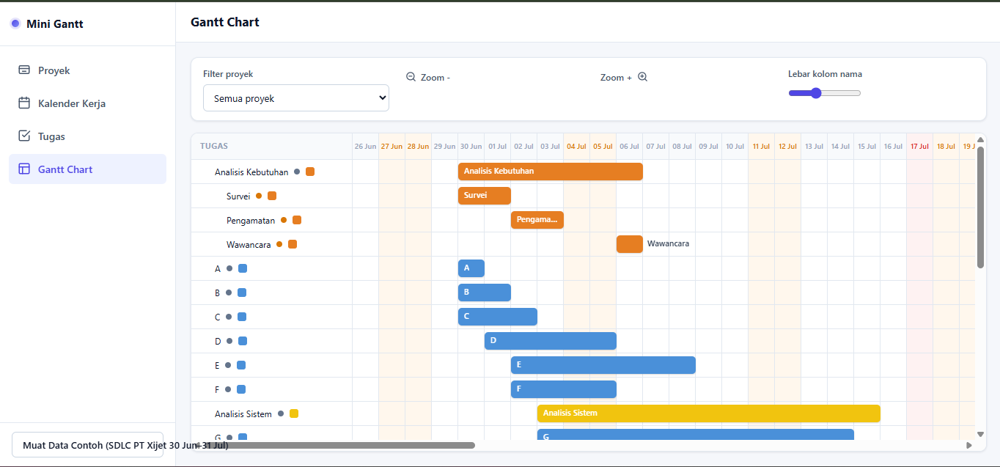
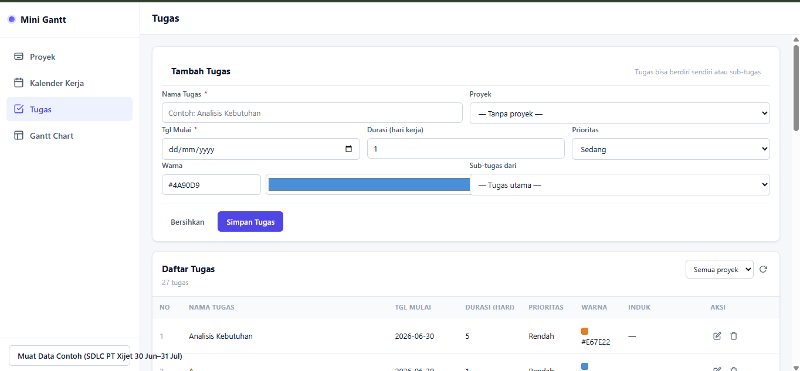

# Mini Gantt Project Manager

Aplikasi web manajemen dan penjadwalan proyek (terinspirasi GanttProject)
yang dibuat dengan bantuan Freebuff CLI untuk tugas Arsitektur Sistem Informasi,
berdasarkan materi Pertemuan 6 (Bab 4).

## Fitur

- Manajemen proyek (nama, organisasi, website, deskripsi)
- Kalender kerja: akhir pekan libur atau tetap kerja, hari libur custom (sekali / berulang)
- Manajemen tugas dan sub-tugas (durasi dalam hari kerja, prioritas, warna)
- Dependensi tugas FS, SS, FF, SF dengan delay, dengan penjadwalan otomatis
- Gantt chart dengan penanda akhir pekan dan hari libur
- Manajemen resource (anggota tim) dan day off pribadi
- Data contoh: SDLC PT Xijet dan contoh critical path

## Teknologi

Node.js, Express, SQLite (better-sqlite3), HTML, CSS, JavaScript.

## Cara Menjalankan

```bash
npm install
npm start
```

Buka http://localhost:3000. Database `gantt.db` dibuat otomatis saat
server pertama kali dijalankan, lengkap dengan data contoh.

## Pengujian

```bash
npm test
```

## Tangkapan Layar




